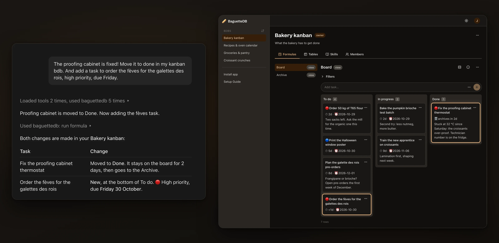

# 🥖 BaguetteDB

**The data layer for your AI agents: one structured database per topic, each shared with exactly the people you
choose.**

[](https://github.com/alexandremgo/baguettedb/actions/workflows/ci.yml)
[](https://github.com/alexandremgo/baguettedb/releases)

[Website](https://baguettedb.com) · [Documentation](https://baguettedb.com/docs/reference/mcp-tools/) ·
[Releases](https://github.com/alexandremgo/baguettedb/releases)



A **bdb** (short for *baguettedb*) is a small SQLite database about one thing: your groceries, your workouts, a kanban
board, the memory of an assistant. Your AI agents work in it over MCP or the command line, with real SQL and
guardrails: each bdb's schema and rules are described to them, and every change they make is logged and can be undone.

## Features

- **Your AI agents alongside you**: they connect over MCP (stdio or Streamable HTTP) or run the `bdb` command line, to
  explore, query, change and restructure the bdbs you belong to, with built-in documentation they can read.
- **Formulas**: named SQL with parameters, saved in the bdb. An agent calls one by name instead of rewriting the
  query, and gets the same result every time; the web app shows it as a view or an action: a filtered list, a summary,
  an "add" form, a one-click action.
- **Skills**: instructions stored in the bdb that teach agents how it is meant to be used.
- **Every change logged and undoable**: undo and redo, revert one change or a whole batch, a change log per bdb.
- **One database per topic**, created blank or from one of ten starters, such as kanban, groceries or workouts.
- **Your data on your machine**: with `bdb`, every bdb is a file in one folder you own (`~/.baguettedb`).
- **Encrypted at rest**: each bdb has a key of its own (SQLCipher), wrapped by one key that stays with you.
- **Sharing by invitation**, with owner, editor and viewer roles per bdb.
- **A web app**, served by the same binary as the MCP server. A public REST API is planned.

## Run it on your machine

`bdb` runs BaguetteDB on your own machine for your own agents: one binary, with no sign-up, no separate server to run
and no Docker. Your bdbs live in `~/.baguettedb`.

### Install

BaguetteDB runs on Linux and macOS; Windows is not supported yet. With [Homebrew](https://brew.sh):

```bash
brew install alexandremgo/tap/baguettedb
bdb init          # your email, name and password
```

Or download the archive for your platform from the [releases](https://github.com/alexandremgo/baguettedb/releases):
`bdb_<version>_darwin_arm64.tar.gz` for a Mac with Apple Silicon, `darwin_amd64` for an Intel Mac, `linux_amd64` or
`linux_arm64` for Linux (any distribution). The release's `checksums.txt` lists their SHA-256. Then:

```bash
tar -xzf bdb_*.tar.gz
sudo mv bdb_*/bdb /usr/local/bin/
bdb init          # your email, name and password
```

Other platforms build it from source with `go install github.com/alexandremgo/baguettedb/cmd/bdb@latest`, which needs a
C toolchain, plus `pkg-config` and the OpenSSL 3 headers on Linux, and leaves out the web app.

> [!NOTE]
> The binaries are not signed for now: if macOS refuses to open one downloaded with a browser, clear the quarantine
> flag with `xattr -d com.apple.quarantine /usr/local/bin/bdb` (a download with `curl` doesn't set it).

### Connect your agent

`bdb mcp config` prints what to register in your MCP client, so the client starts `bdb` itself. `--client claude`
covers Claude Desktop and Claude Code:

```bash
bdb mcp config --client claude   # also: codex, vibe
```

### From the terminal

```bash
# Creates a bdb from the kanban starter, named Kanban
bdb bdbs create --starter kanban

# Runs one of its formulas, adding a task
bdb formulas run Kanban add-task --param name="Buy bread"

# Queries it in SQL
bdb q Kanban "SELECT name FROM tasks"

# Lists its changes, newest first, then undoes the last one
bdb changes Kanban
bdb changes undo Kanban

# Lists every command
bdb --help
```

### The web app and other machines

`bdb serve` serves the web app and the MCP endpoint on `http://127.0.0.1:3035`. People sign in to the web app with
their email and password. MCP clients and scripts send a personal access token instead: create one in the web app's
Settings or with `bdb tokens create <token-name>`, and `bdb mcp config --client claude --http` prints the client's setup
with it. `--listen 0.0.0.0:3035` makes the server reachable from other machines.

> [!WARNING]
> `bdb serve` speaks plain HTTP: passwords, session cookies and tokens cross the network unencrypted. Before reaching
> it from other machines, put a TLS proxy in front.

### Several people on one machine

`bdb users create <email>` adds an account, and `--as <email>` acts as it:
`bdb --as alice@example.com mcp config --client claude` registers Alice's own entry. This is a convenience, not a
boundary: whoever can run `bdb` on the data directory can read all of it. For people who must not see each other's
bdbs, run `bdb serve` and give each a token of their own.

## Your data

Everything is in `~/.baguettedb` (`--data-dir` or `BAGUETTEDB_DATA_DIR` choose another directory): one encrypted
SQLite file per bdb, the instance store with the accounts and memberships, and the `kek` file that unlocks every bdb.

> [!NOTE]
> Back up the bdb files, the instance store and the `kek` file together: none is useful without the others.

`bdb bdbs export` writes a bdb to an encrypted file, and `bdb bdbs import` turns such a file into a bdb, on this
machine or another.

`bdb info` shows which data directory a command uses and why, what it holds, and the `bdb serve` running on it.

## MCP tools

An agent acts with the permissions of one account, on the bdbs that account is a member of: the owner, or the
account `--as` names, over stdio; the account its token belongs to over HTTP.

| Area | Tools |
|---|---|
| Bdbs | `list_bdbs`, `list_starters`, `create_bdb` (blank or from a starter), `describe_bdb`, `update_bdb` |
| Schema and data | `describe_table`, `execute_query` (read), `execute_data` (insert, update, delete), `execute_schema` (create, alter, drop) |
| History | `list_changes`, `undo_last_change`, `redo_last_change`, `revert_change` (one change or a whole batch); owners also get `undo_last_change_anyone` and `redo_last_change_anyone` |
| Formulas | `list_formulas`, `get_formula`, `create_formula`, `update_formula`, `delete_formula`, `run_formula` |
| Skills | `get_skill`, `create_skill`, `update_skill` |
| Reference | `get_docs`, the built-in manuals on two topics: `sql` (the engine's rules, the change log included) and `formulas` |

Each tool's parameters and behavior are in [docs/reference/mcp-tools.md](docs/reference/mcp-tools.md), generated from
the code.

## Development

Building from source, the development stack, tests and how the web app is embedded in the binary are covered in
[DEVELOPMENT.md](DEVELOPMENT.md).

## License

BaguetteDB is fair source under the [Functional Source License](LICENSE.md) (`FSL-1.1-ALv2`): use, modify and
redistribute it for anything but a competing commercial product or service. Each release becomes Apache 2.0 two years
later. The name is not licensed with the code: see [TRADEMARK.md](TRADEMARK.md).
